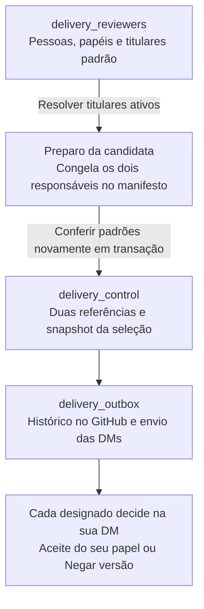

# Aprovadores: titulares automáticos e substitutos

**Integrado na main, migração aplicada e titulares automáticos validados em DMs
reais no ensaio solo de 15/10/2026. Promoção final bloqueada; worker e receptor
pausados ao encerrar.** Veja os [resultados e limites](evidence/reviewer-defaults/README.md).
Este guia se aplica somente ao projeto
`israelhudson/flutter_code_push_example` e ao Supabase exclusivo
`xtvueqciogzkyjkkqxcx`. Não modifica banco, bot ou regras da Amulets.

O operador não escolhe pessoas a cada Run workflow. O cadastro define um titular
técnico e um de negócio; cada preparo usa esses padrões automaticamente.



## Três tabelas, com responsabilidades distintas

| Tabela | O que guarda | O que muda |
|---|---|---|
| `delivery_reviewers` | Uma pessoa por repositório/workspace: nome, IDs, papéis, situação e titularidade | Nova tabela |
| `delivery_control` | Responsáveis e aceites de cada candidata | Adiciona duas FKs e `reviewer_snapshot` |
| `delivery_outbox` | Tarefas, tentativas e recibos | Mantém a tabela e as relações existentes |

O nome da pasta `two-table-state` foi preservado para não quebrar links de
evidências antigas. A extensão aprovada acrescenta a terceira tabela de cadastro;
não recria as tabelas legadas nem cria uma quarta tabela de auditoria.

Campos do cadastro:

| Grupo | Campos |
|---|---|
| Identidade | `id`, `repository`, `name`, `slack_team_id`, `slack_user_id` |
| GitHub opcional | `github_user_id`, `github_login` |
| Elegibilidade | `can_technical`, `can_business`, `active` |
| Titulares automáticos | `default_technical`, `default_business` |
| Versão do cadastro | `revision`, `created_at` |

Slack é identificado por workspace e ID do usuário, não por apelido. GitHub não é
obrigatório para uma pessoa que só avalia na DM; cadastrar um login não concede
acesso a repositórios, revisão de PR ou permissão de merge. Não armazenamos tokens
ou senhas nessa tabela e não criamos usuários no Supabase Auth.

Os índices impedem dois titulares do mesmo papel por repositório. O resolver
exige exatamente um titular ativo e habilitado por papel no workspace esperado.
Falta de titular bloqueia o preparo: não há escolha automática de substituto por
ordem do cadastro, presença no Slack ou primeiro usuário encontrado.

## Política no GitHub, pessoas no banco

`delivery/delivery-policy.json` continua definindo repositório, workspace, canal,
operador, branches e modo solo. A fonte passa a ser `reviewer_source: database-v1`;
os blocos `technical` e `business` saem do arquivo. Não há fallback para as antigas
pessoas do JSON em novos preparos ou registros.

O RPC `delivery_resolve_reviewers(repository, team, solo)` devolve um snapshot
`delivery-reviewers-v1`, com os dois responsáveis e suas revisões cadastrais. O
preparo o inclui em `manifest.reviewers`; o CLI não aceita eleger aprovadores em
campos arbitrários do pedido. O registro compara novamente os padrões do banco
com esse snapshot, sob bloqueio transacional. Se alguém mudou o cadastro entre
planejamento e registro, a candidata não é registrada com pessoas diferentes do
manifesto. O operador deve reconciliar o preparo e as referências existentes;
não sobrescrever tags para contornar a recusa.

A candidata recebe `technical_reviewer_id`, `business_reviewer_id` e
`reviewer_snapshot`, preservando os IDs Slack em `technical_user` e
`business_user`. Manifesto, controle e novos eventos no GitHub guardam a mesma
seleção. Retentativa do mesmo manifesto confere commit, digest e identidade, sem
ler os titulares atuais para trocar destinatários.

## Israel nos dois papéis: somente ensaio solo

A migração cadastra Israel uma única vez, habilitado e titular nos dois papéis:
Slack `U0BMFQKC001`, workspace `T09CYB7AS77`, GitHub `israelhudson` / ID `18661493`.
A política `solo: true` permite essa seleção. São dois aceites e duas DMs de
papéis diferentes para a mesma pessoa; não é prova de duas pessoas independentes.

Com `solo: false`, o resolver recusa a mesma pessoa para técnico e negócio. A
política e o cadastro da Amulets precisam ser decididos com Samuel antes da adoção.

## Quem administra e como trocar um titular

Não há painel, endpoint de cadastro ou permissão de edição para o bot. A tabela
tem RLS habilitado; `anon` e `authenticated` não recebem acesso. O runtime com
`service_role` tem somente `SELECT` no catálogo, além da execução dos RPCs
necessários. Administração usa SQL privilegiado, versionado em PR/migração e
aplicado por um operador autorizado. Não se entrega credencial privilegiada aos
avaliadores.

Procedimento para uma substituição planejada:

1. Cadastrar o substituto com IDs conferidos e papel habilitado, sem titularidade.
2. Registrar no PR o pedido, autor, motivo, titular anterior e substituto. A
   aplicação e a leitura de conferência devem ter logs privados, sem secrets.
3. Em **uma transação**, remover o padrão anterior e ativar o novo. Não publicar
   um estado intermediário entre essas duas alterações.
4. Conferir o resolver após o commit. Os próximos preparos usarão o novo titular.

Modelo de troca do titular de negócio, para transformar em migração auditada.
O UUID abaixo é ilustrativo e deve ser substituído pelo cadastro real existente:

```sql
begin;
do $change$
declare
  substitute uuid := '00000000-0000-4000-8000-000000000002';
begin
  perform pg_advisory_xact_lock(1515003);
  if not exists (
    select 1 from public.delivery_reviewers
    where id = substitute
      and repository = 'israelhudson/flutter_code_push_example'
      and slack_team_id = 'T09CYB7AS77'
      and active and can_business
  ) then
    raise exception 'Substituto inexistente, inativo ou sem papel de negócio';
  end if;
  update public.delivery_reviewers set default_business = false
  where repository = 'israelhudson/flutter_code_push_example'
    and default_business;
  update public.delivery_reviewers set default_business = true
  where id = substitute;
end
$change$;
commit;

select public.delivery_resolve_reviewers(
  'israelhudson/flutter_code_push_example', 'T09CYB7AS77', true
);
```

Uma troca do titular técnico segue a mesma regra usando `can_technical` e
`default_technical`. O trigger incrementa `revision` a cada alteração. Não editar
essa revisão manualmente. Identidade Slack, projeto e ID interno são imutáveis;
outra identidade exige outro cadastro. O nome e os metadados GitHub podem ser
corrigidos com nova revisão, sem reescrever snapshots anteriores.

A tabela não registra sozinha quem executou cada SQL administrativo. Por isso,
PR/migração e log de aplicação são parte obrigatória do procedimento de auditoria;
editar diretamente sem esse registro deixa uma lacuna de histórico administrativo.

## Avaliações abertas e histórico

Trocar apenas o padrão não troca quem já foi designado. Se os designados
continuarem ativos e habilitados, suas DMs seguem válidas para aquela candidata.
O substituto não herda aceites e não pode usar a DM de outra pessoa.

Inativar um designado ou retirar seu papel bloqueia novas decisões daquela
avaliação, inclusive quando o outro papel tenta decidir. Uma decisão já gravada
continua no histórico e seu callback repetido permanece idempotente. Isso não é
rollback automático de uma publicação já iniciada.

A autorização dos dois designados também é conferida antes do dispatch e da
primeira reserva de publicação. Assim, revogação após os dois aceites ainda pode
impedir que a publicação comece. Uma publicação já reservada precisa continuar
podendo ser reconciliada; cadastro não desfaz um efeito externo já confirmado.

Para uma substituição durante a avaliação, o procedimento é cancelar a candidata
antes do dispatch e preparar uma nova RC, com novos responsáveis, mensagens e zero
aceites. Preservar a tag anterior. Publicação iniciada exige reconciliação do run;
trocar o cadastro não interrompe um job externo por conta própria.

As candidatas anteriores à migração ficam com as novas FKs e snapshot nulos.
Continuam usando seus IDs congelados, sem exigir que seus antigos responsáveis
sejam cadastrados agora. Seus eventos e manifests não são reescritos. FKs com
`ON DELETE RESTRICT` impedem apagar pessoas referenciadas por novas candidatas;
preferir inativar o cadastro em vez de excluí-lo.

## Implantação e validação antes de ativar

Migração: `supabase/migrations/20261015132214_delivery_reviewer_defaults.sql`.
As alterações são aditivas ao controle e não removem nenhuma candidata ou aceite.

1. Fazer backup privado de estado, funções e permissões do projeto exclusivo.
2. Manter `POC_SLACK_PUBLISH_ENABLED=false`, `POC_PUBLICATION_ENABLED=false`,
   `POC_SLACK_ENABLED=false` e `POC_LEGACY_ENABLED=false`. Worker e receptor v2
   ficam pausados até a janela controlada.
3. Aplicar a migração e implantar o receptor correspondente, com entrada pausada.
   Conferir três tabelas públicas de aplicação, grants do catálogo, titulares e
   preservação das candidatas, aceites, tags e histórico existentes.
4. Testar RPC, worker e DMs em ensaio autorizado `controls_only`, escopo `none`.
   Promoção final permanece bloqueada. Esse modo dispensa build, preview e patch,
   mas o preparo normal ainda cria a **tag RC e a GitHub prerelease da candidata**.
   `none` impede o dispatch da publicação final; não elimina os registros de candidata.
5. Guardar logs e prints do catálogo, resolução automática, duas DMs e decisões.
   Confirmar zero dispatch/publicação. Encerrar a fixture sem pendências e pausar
   novamente o worker/receptor.

Cobertura local: defaults solo e distintos, falta/duplicidade de titular,
troca concorrente, snapshot divergente, usuário não designado, revogação, RLS/grants,
histórico legado, retry e rejeição/RC2. Testes locais usam SQL real em PGlite e
fixtures HTTP; seus resultados não devem ser confundidos com testes remotos de
troca de titular, revogação ou concorrência entre sessões reais.

Em 15/10, o [PR #62](https://github.com/israelhudson/flutter_code_push_example/pull/62)
foi integrado na `main`; a migração foi aplicada somente ao projeto exclusivo e
a candidata `1.15.3 RC1`, em `controls_only`/`none`, usou os titulares do banco.
As duas DMs receberam aceites da conta de Israel, e o operador cancelou a candidata
para encerrar o ensaio. Seus 16 trabalhos terminaram, sem dispatch ou run de
publicação. O banco ficou com três tabelas de aplicação, zero pendências e os
registros anteriores preservados. Foram criadas a tag `poc-v1.15.3-rc.1` e sua
prerelease; não foram criados tag estável, Release final, preview ou patch.

O worker/receptor foi pausado novamente e os controles de promoção permaneceram
desligados durante toda a rodada. O [relatório da rodada](evidence/reviewer-defaults/README.md)
liga os runs, a prova sanitizada e os limites da validação.

Antes da Amulets: validar com duas contas distintas, definir administradores,
restaurar revisão humana dos PRs e acordar o procedimento operacional de
substituição. Nenhum cadastro no banco substitui as permissões do GitHub ou os
controles de publicação da esteira.
