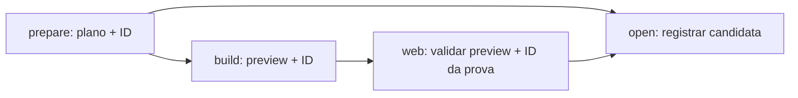

# Artefatos exatos entre os jobs de preparação

A [rodada 1.15.8, run 38819229078](https://github.com/israelhudson/flutter_code_push_example/actions/runs/38819229078)
expôs dois artefatos chamados `poc-preparation` após um novo preparo no mesmo run:

| Tentativa produtora | Conteúdo observado | ID do artefato | Criação em UTC |
|---|---|---|---|
| 1 | Bloqueio antes do corte | `12012656257` | 15/10/2026 22:45:27 |
| 2 | Plano da candidata | `12012492009` | 15/10/2026 22:47:04 |

O ID maior pertencia ao mais antigo. A seleção por nome da action pinada
`download-artifact` 8.0.2 escolhe o maior ID entre duplicatas; não compara a data.
Somente passar `artifact-ids` também seria insuficiente: o ramo de IDs dessa
versão aplica `listArtifacts({latest: true})` antes de filtrar, mantendo apenas
o maior ID de cada nome.

## Contrato corrigido

Cada upload agora recebe o sufixo `-attempt-${{ github.run_attempt }}`. Os
prefixos, conteúdo, retenção e finalidade continuam os mesmos. Os três
produtores exportam o `artifact-id` retornado pelo upload, e seus consumidores
usam esse ID por `needs`; não buscam por nome nem calculam nomes pela tentativa
do consumidor.

| Produtor | Nome do upload | Output do job | Consumidor |
|---|---|---|---|
| `prepare` | `poc-preparation-attempt-N` | `preparation_artifact_id` | `open` |
| `build` | `poc-built-preview-attempt-N` | `preview_artifact_id` | `web` |
| `web` | `poc-web-proof-attempt-N` | `proof_artifact_id` | `open` |

O relatório final também usa `poc-candidate-report-attempt-N`. O artefato interno
do serviço Pages mantém o contrato da action `upload-pages-artifact`.

Se o produtor rodou na tentativa 2 e só o consumidor for reexecutado na 3, ele
continua recebendo o ID exportado pelo produtor da 2. Nomes diferentes por
tentativa evitam que o `latest: true` descarte esse ID quando a tentativa 1 tem
um número maior. Antes de qualquer download, um ID vazio ou não numérico falha
explicitamente, evitando que a action interprete a ausência como “baixar todos”.



Em `controls_only`, `build` e `web` continuam pulados; `open` exige somente o
ID do plano. Em `full`, continua exigindo a publicação Web bem-sucedida e o ID
da prova. Nenhum controle, aceite, decisão, tag, contrato de banco ou fluxo
legado/LAB/Issue é alterado. A correção não cria uma candidata nem publica nada
por si só, e não modifica a execução histórica citada acima.

## Validação e limites

O teste `test_poc_delivery_artifact_ids.py` verifica a ligação upload → output
do produtor → download por ID, os nomes por tentativa, IDs inválidos e os dois
modos. Uma fixture offline representa produtor 1 bloqueado, produtor 2 com ID
menor e consumidor reexecutado na tentativa 3. Ela verifica o contrato de
seleção, sem simular sucesso remoto, download real ou novo aceite.

Validação local: **89 testes** de `test_poc*.py` passaram, incluindo os cinco
novos contratos e as regressões de cenários, publicação e Android staging.
`actionlint` **1.7.12** aprovou o workflow oficial; verificadores externos
ShellCheck/Pyflakes foram desativados nesse comando. O binário oficial foi
conferido contra o checksum publicado. `git diff --check` também passou.

```bash
python3 -m unittest discover -s tests/delivery -p 'test_poc*.py' -v
actionlint -shellcheck= -pyflakes= .github/workflows/delivery-prepare.yml
```

Esses checks comprovam os contratos locais. Uma execução futura da alteração
integrada deverá confirmar o transporte real dos artefatos entre jobs.

Fontes oficiais da versão pinada:

- [Seleção por nome e ramo de IDs](https://github.com/actions/download-artifact/blob/9000827ccba6bdab643e8b6fd33ac0654aef8333/src/download-artifact.ts).
- [SDK incluído: seleção pelo maior ID e `filterLatest`](https://github.com/actions/download-artifact/blob/9000827ccba6bdab643e8b6fd33ac0654aef8333/dist/index.js#L126969).

Logs brutos, capturas e snapshots permanecem no armazenamento privado da rodada.
Este documento contém apenas identificadores e o diagnóstico sanitizado.
