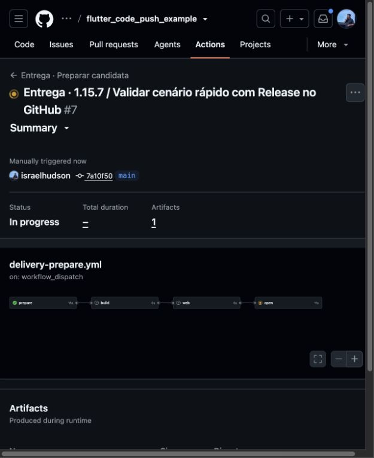
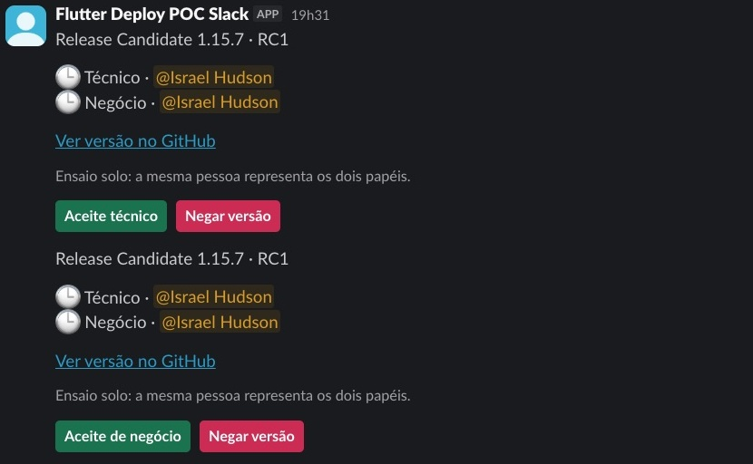
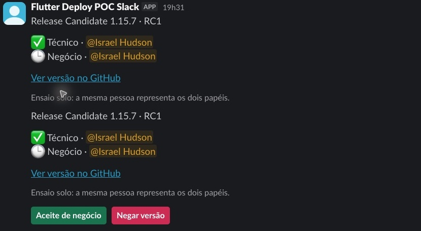
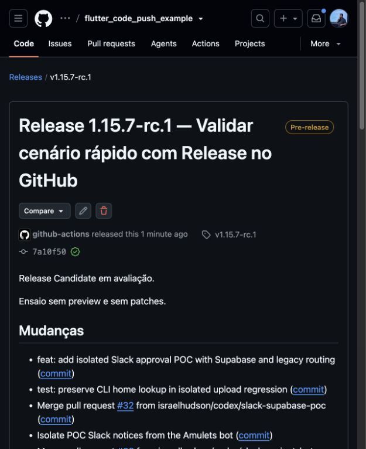
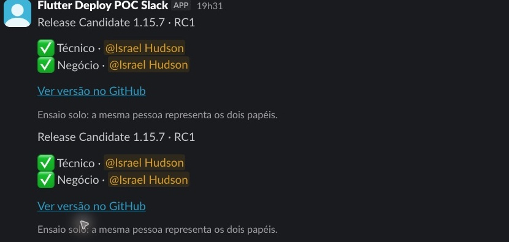
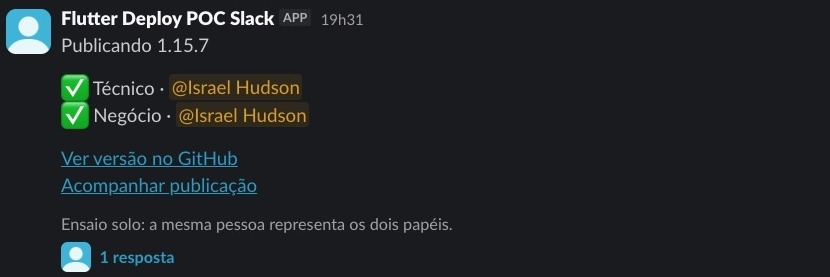
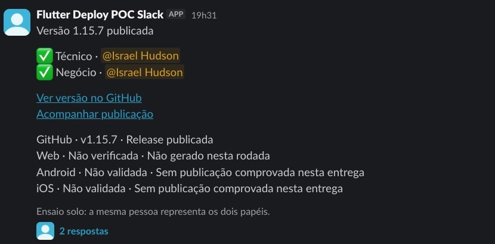
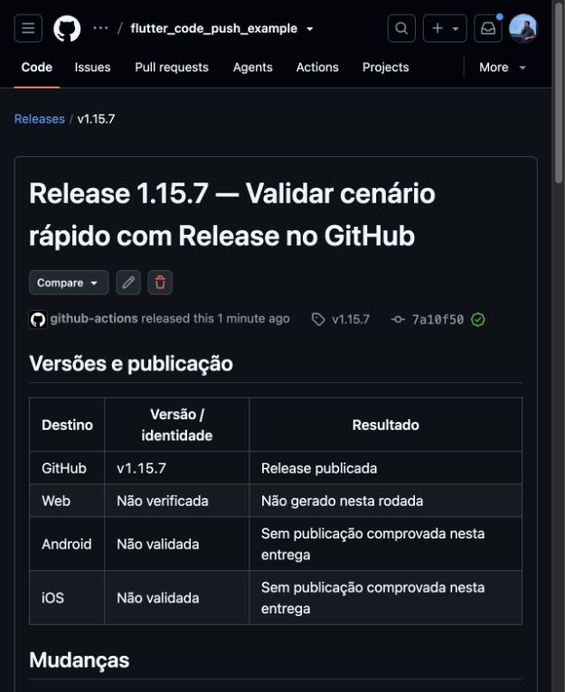
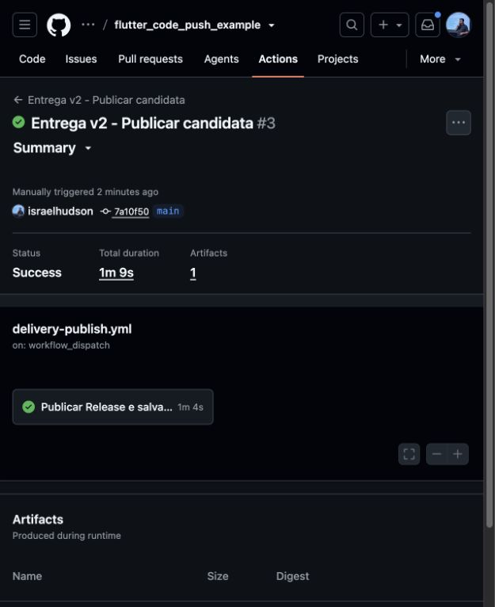

# Validação 1.15.7 — teste rápido com Release no GitHub

**Concluída em 15/10/2026:** a candidata recebeu os dois aceites reais nas DMs
e gerou automaticamente a [Release `v1.15.7`](https://github.com/israelhudson/flutter_code_push_example/releases/tag/v1.15.7),
sem preview Web ou patch. A Release final foi publicada às **19:33:45,
America/Fortaleza** (`22:33:45Z`).

Esta foi a primeira rodada real da interface por cenário integrada pelo
[PR #66](https://github.com/israelhudson/flutter_code_push_example/pull/66).
A automação e o aplicativo vieram da `main`, no commit
`7a10f5086c5305524b9b13e40703cc2e9020c627`.

## Parâmetros e resultado

| Item | Valor comprovado |
|---|---|
| Cenário no formulário | Teste rápido com Release no GitHub |
| Identificador na CLI | `release_only` |
| Versão e título | `1.15.7` · Validar cenário rápido com Release no GitHub |
| Tradução interna | `github_test` / `controls_only` / `none` |
| Branch da entrega | `release/1.15.7` |
| Candidata preservada | [`v1.15.7-rc.1`](https://github.com/israelhudson/flutter_code_push_example/releases/tag/v1.15.7-rc.1) |
| Release final | `v1.15.7`, `draft=false`, `prerelease=false` |
| Código publicado | Mesmo SHA da candidata; nenhuma tag movida |
| Duplicação | Um preparo e um dispatch de publicação |
| Preview e patch | Nenhum; jobs `build` e `web` pulados |
| Encerramento | 23 tarefas concluídas, zero pendências; controles pausados |
| Banco | As três tabelas existentes, sem migração |

## Etapas observadas

1. O histórico, as tags, as Releases e a fila foram conferidos antes do disparo.
   A versão ainda não existia e não havia outra candidata ativa.
2. A CLI foi simulada e, depois, executada uma única vez na `main`.
   O [preparo 38817614027](https://github.com/israelhudson/flutter_code_push_example/actions/runs/38817614027)
   concluiu `prepare` e `open`; `build` e `web` terminaram como `skipped`.
3. A candidata e as duas DMs foram criadas. O aceite técnico real foi registrado
   às **19:32:07**. A candidata permaneceu pendente, sem disparo de publicação.
4. O aceite de negócio real foi registrado às **19:32:37**. A confirmação dos
   dois aceites no histórico precedeu um único dispatch automático.
   Os [workers 38817767795](https://github.com/israelhudson/flutter_code_push_example/actions/runs/38817767795)
   e [38817823317](https://github.com/israelhudson/flutter_code_push_example/actions/runs/38817823317)
   registram o processamento dos aceites e os recibos.
5. A [publicação 38817869790](https://github.com/israelhudson/flutter_code_push_example/actions/runs/38817869790)
   concluiu com sucesso. O cartão e as duas DMs foram atualizados nos mesmos
   registros; avisos apareceram no canal/thread, sem menção coletiva.
6. As 46 tags e 23 Releases anteriores foram preservadas. Somente a candidata
   e a final desta versão foram acrescentadas. A fila terminou vazia e os
   controles do fluxo voltaram ao estado pausado.

Os dois cliques foram feitos por Computer Use na conta Israel, que representa
os papéis técnico e de negócio no ensaio solo. **Esta rodada não comprova
aprovação por duas pessoas independentes, preview ou distribuição mobile.**
Não foi necessária correção de código durante a execução.

## Logs e conferência

- [Extrato sanitizado da execução](execution-sanitized.log): projeção dos
  artefatos reais de preparo, eventos e recibo da publicação, com lista explícita
  de campos permitidos. Não é um log completo de runner nem saída simulada.
- [Conferência estruturada](verification.json): parâmetros, SHA, links dos runs,
  resultados, horários, contagens e coordenadas dos recortes publicados.
- O histórico permanente permanece no GitHub, na branch `codex/delivery-history`.
  Os originais integrais e snapshots privados não foram copiados para esta pasta.

## Prints reais da rodada

As capturas GitHub foram preservadas como estavam. Os prints Slack foram
**recortados**, sem reconstruir mensagens ou alterar seus textos: foram
excluídos sidebar, cabeçalho do workspace, conversas e canais alheios.
Permanecem apenas as mensagens desta versão, o nome do bot e o nome da conta
Israel usada nos dois papéis. O nome visual do bot ainda contém “POC”; ele é
parte da captura real, não o nome da entrega.

### 1. Preparo da candidata, build e Web pulados

### 2. DMs aguardando os aceites

### 3. Aceite técnico recebido; negócio pendente

### 4. Candidata no GitHub, sem preview

### 5. Dois aceites recebidos

### 6. Publicação iniciada automaticamente

### 7. Cartão atualizado para versão publicada

### 8. Release final no GitHub

### 9. Pipeline de publicação concluído

## Limites e próximos usos

O cenário rápido validou a interface nova, a separação dos dois papéis, o
dispatch único e a publicação GitHub. A tabela informa corretamente a ausência
de entregas Web, Android e iOS nesta rodada. Uma rodada com preview e Android
staging exige evidência própria e não deve ser atribuída à 1.15.7.

Antes da adoção na Amulets, permanece necessário restaurar as regras humanas
acordadas para revisão de PR e validar os aceites com contas distintas.
