# Validação 1.15.8 — preview e patch Android em staging

**Resultado:** preview Web validado, dois aceites reais no Slack, Release GitHub
publicada automaticamente e **Android `1.1.0+2`, patch 6 em staging**.
Os cinco patches anteriores foram preservados, incluindo stable 1, 2 e 3.
A execução do patch em dispositivo continua **não comprovada**.

| Destino | Versão / identidade | Resultado comprovado |
|---|---|---|
| GitHub | [`v1.15.8`](https://github.com/israelhudson/flutter_code_push_example/releases/tag/v1.15.8) | Release publicada automaticamente |
| Web | `1.1.0+2`, código `d1b5e82` | Preview validado; não comprova produção |
| Android | `1.1.0+2 (patch 6)` | Upload em staging; execução em dispositivo não comprovada |
| iOS | Não validada | Sem publicação comprovada nesta rodada |

A automação partiu da `main`, no commit
`d1b5e8251ec051bbccdae7d9462bb1c2f5d1b026`. A branch `release/1.15.8`, a
[candidata `v1.15.8-rc.1`](https://github.com/israelhudson/flutter_code_push_example/releases/tag/v1.15.8-rc.1)
e a versão final apontam para esse código. A identificação visível do ensaio
foi integrada pelo [PR #68](https://github.com/israelhudson/flutter_code_push_example/pull/68).

## O caminho completo

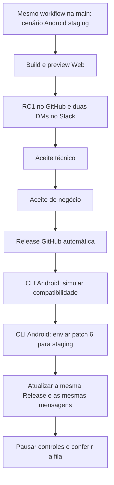

O cenário usado foi **Android staging — preview, Release e patch via CLI**,
identificador `android_staging`. Ele resolveu `github_test / full /
android_staging`. A Release GitHub foi automática após os aceites; o patch foi
uma etapa CLI posterior e autorizada, com simulação antes do upload.

## 1. Preview Web disponível

O build e o smoke do [preview real](https://israelhudson.github.io/flutter_code_push_example/snapshots/d1b5e8251ec051bbccdae7d9462bb1c2f5d1b026/)
concluíram no SHA da candidata. Isso comprova o preview Web desta entrega.

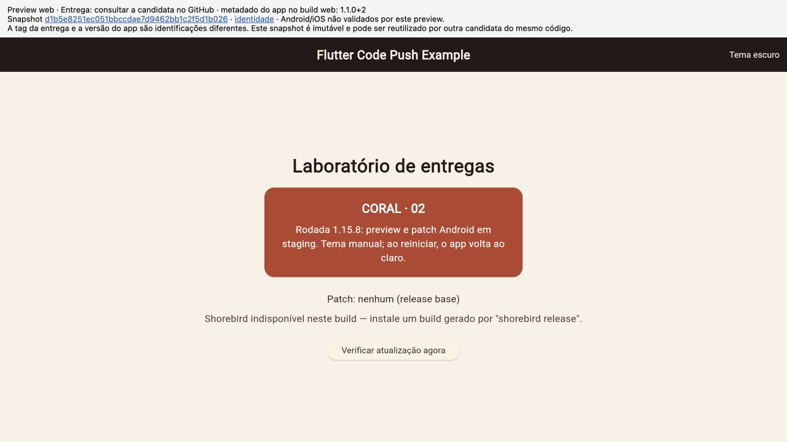

## 2. Release candidata no GitHub

O pré-lançamento da RC1 apresentou o link do preview para avaliação.

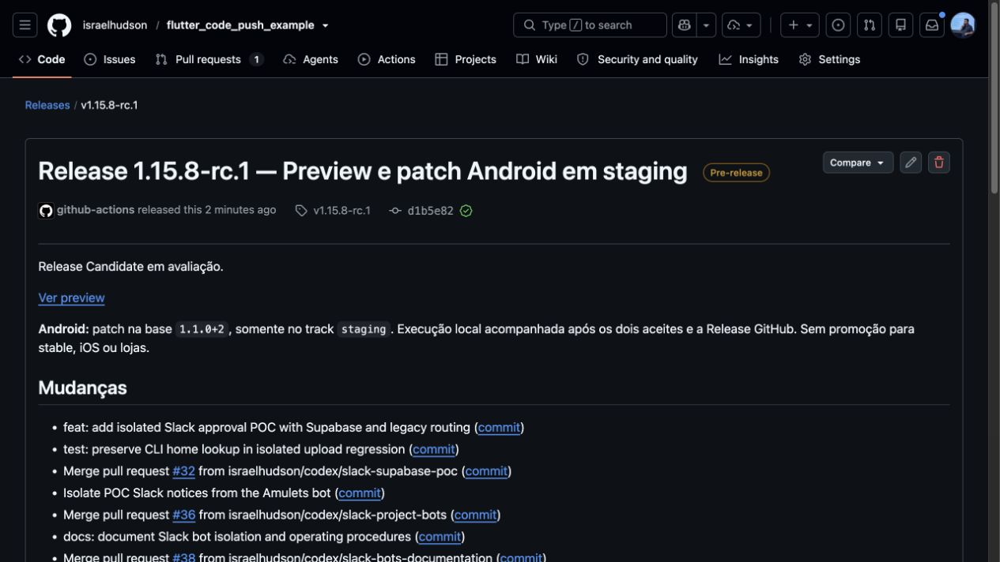

## 3. Duas DMs aguardando os aceites

O ensaio usa a conta Israel nos dois papéis. Cada mensagem apresenta o aceite
do respectivo papel e a opção de negar a versão.

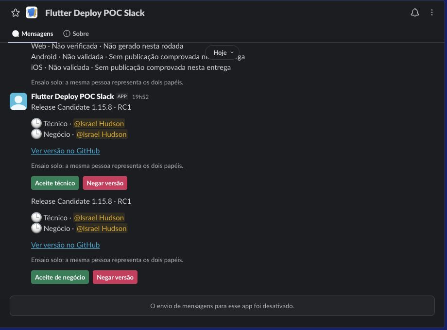

## 4. Primeiro aceite: a avaliação continua pendente

O aceite técnico foi registrado às **19:53:39 de 15/10/2026**, no horário de
Fortaleza. A publicação ainda não foi disparada.
O [worker técnico](https://github.com/israelhudson/flutter_code_push_example/actions/runs/38820146701)
registrou o processamento e seus recibos.

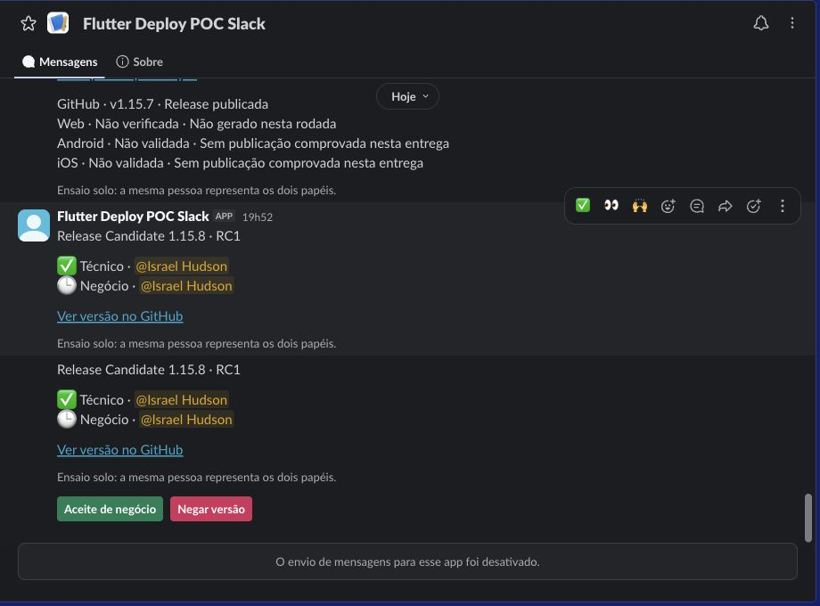

## 5. Segundo aceite: publicação automática autorizada

O aceite de negócio foi registrado às **19:54:14**. O
[worker de negócio](https://github.com/israelhudson/flutter_code_push_example/actions/runs/38820207783)
confirmou os dois aceites no histórico e fez um único dispatch de publicação.

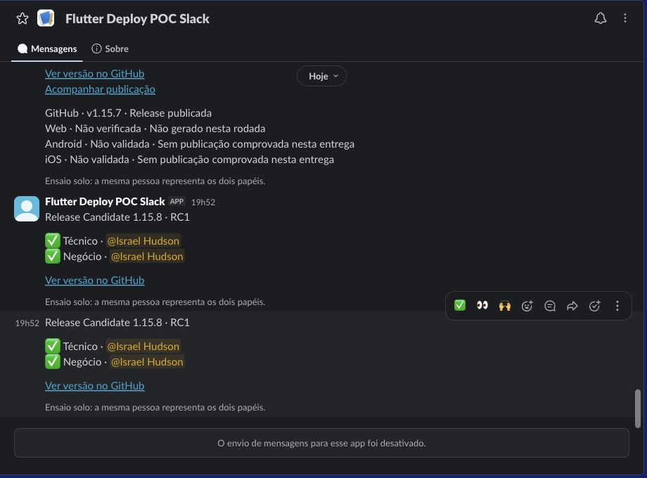

## 6. Slack mostra a publicação em andamento

O cartão apresentou o estado publicando e o link de acompanhamento.

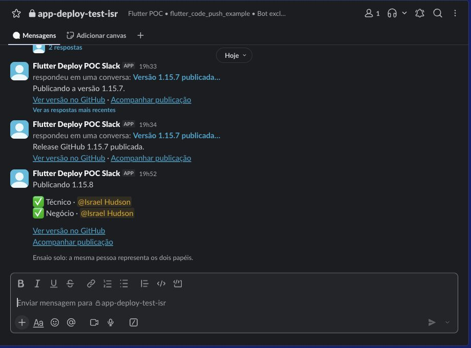

## 7. Release GitHub publicada; Android ainda pendente

A [publicação 38820254448](https://github.com/israelhudson/flutter_code_push_example/actions/runs/38820254448)
concluiu com sucesso. A Release final foi criada às **19:55:26**, sem rótulo de
pré-lançamento. Nesse marco, o patch ainda não tinha sido enviado: o Slack
mostrou explicitamente **Android staging pendente**.

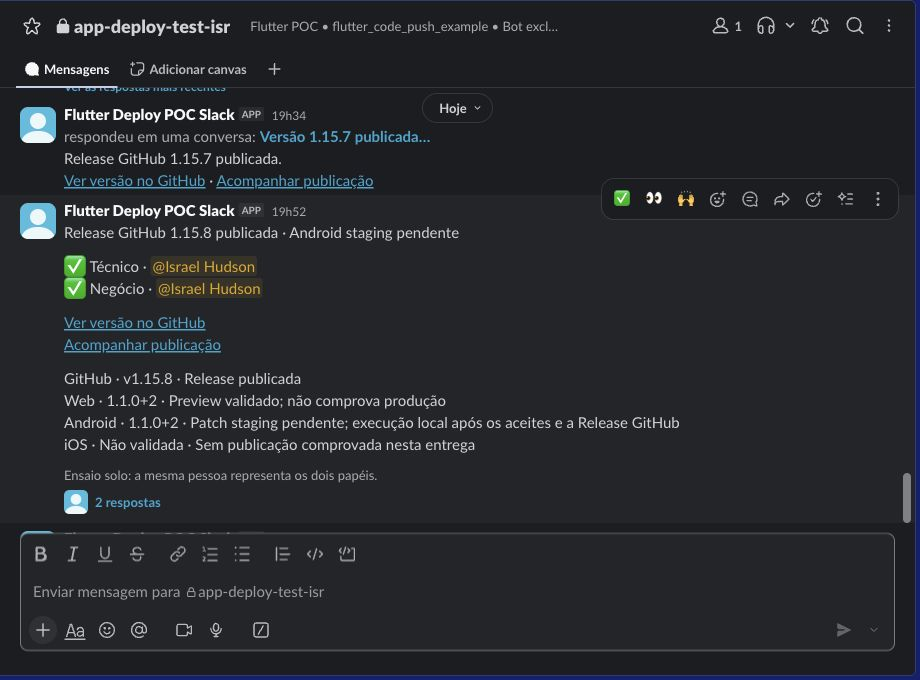

## 8. Patch CLI enviado; mesma mensagem atualizada

A ponte CLI confirmou a base `1.1.0+2` e Flutter `3.44.9`. A simulação passou;
o upload seguinte criou o **patch 6**, ID `723169`, somente em staging.
Os hashes das arquiteturas `aarch64`, `arm` e `x86_64` conferem entre o AAB
local, o recibo e o provedor.

O [refresh 38820839479](https://github.com/israelhudson/flutter_code_push_example/actions/runs/38820839479)
concluiu com sucesso e atualizou a mesma Release e as mesmas três mensagens:
cartão do canal e duas DMs. Os dois aceites foram preservados.

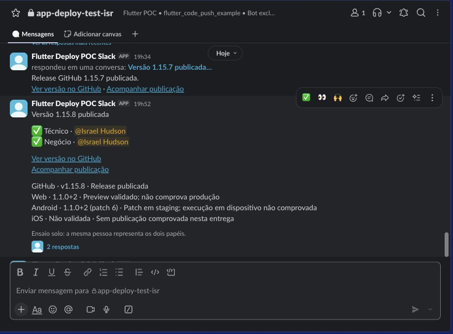

## 9. Tabela final da Release

A tabela passou a mostrar `1.1.0+2 (patch 6)` e manteve a ressalva de execução
em dispositivo não comprovada. Não houve promoção stable ou publicação em loja.

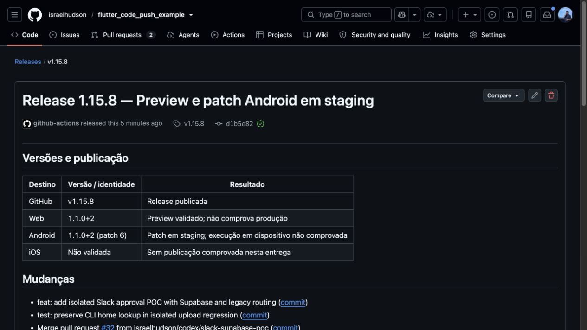

## 10. Aviso do marco Android no canal

Além de editar as mensagens existentes, o fluxo registrou o aviso de patch
disponível em staging. Isso torna a novidade visível no acompanhamento do canal.

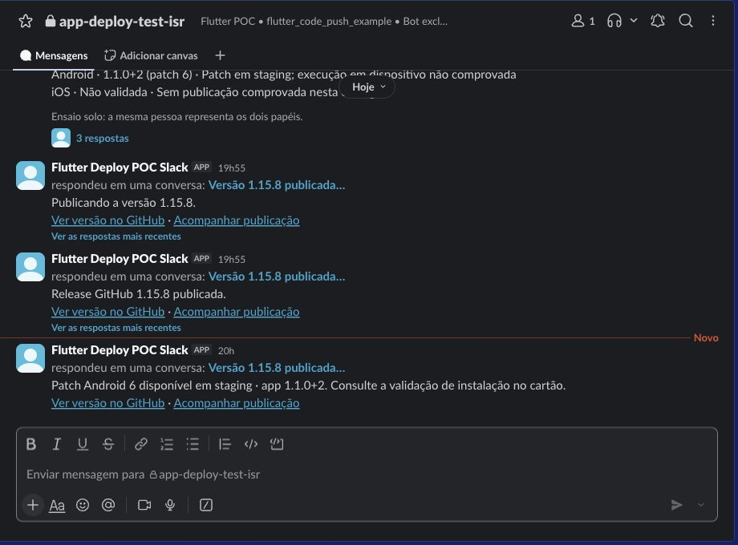

Detalhes da recuperação da mesma RC1

O [preparo 38819229078](https://github.com/israelhudson/flutter_code_push_example/actions/runs/38819229078)
precisou de três tentativas:

1. A primeira bloqueou antes de criar referências, aguardando os contratos do
   commit integrado na `main`. O check do PR não substituiu esse check.
2. Na segunda, `prepare`, `build` e `web` concluíram. O job `open` baixou o
   artefato antigo de bloqueio `poc-preparation`, ID `12012656257`, e não o plano
   válido da candidata. O registro permaneceu bloqueado.
3. O artefato antigo foi salvo antes da remoção, com SHA-256
   `f3189f0517819aea6e42c692dacf64e4d1d02753ed8a7a88a62413fc9ce8ba50`.
   Após autorização explícita, somente esse artefato foi removido. A
   [tentativa 3](https://github.com/israelhudson/flutter_code_push_example/actions/runs/38819229078/attempts/3)
   reexecutou **somente o job `open` que falhou** e reutilizou os resultados e
   artefatos válidos da tentativa 2.

A recuperação preservou a mesma RC1, suas tags, o preview e os logs. Não houve
mudança de código que exigisse outra avaliação ou uma RC2.
O [PR #69](https://github.com/israelhudson/flutter_code_push_example/pull/69)
reúne a correção da seleção de artefatos em reruns. Essa evolução é posterior
à rodada e não compõe o código `d1b5e82` aprovado aqui.

## Encerramento e limites

| Conferência | Resultado |
|---|---|
| Tags e Releases anteriores | Preservadas; somente RC1 e final da 1.15.8 acrescentadas |
| Patches anteriores | Cinco preservados, incluindo stable 1, 2 e 3 |
| Candidata | `published`, revisão 5, mesmos aceites e mensagens |
| Dispatch | Um dispatch de publicação; nenhum duplicado |
| Fila da candidata | 28 tarefas concluídas e três avisos |
| Fila global ao encerrar | 222 tarefas concluídas; zero pendências após a pausa |
| Candidatas ativas | Zero |
| Banco | Três tabelas existentes; nenhuma migração nesta rodada |
| Controles | Worker e publicação pausados; legado desligado |

Os dois papéis foram exercidos pela mesma conta. Isso não comprova revisão por
duas pessoas independentes. O preview e o upload Shorebird não comprovam
execução no aparelho; ainda falta validar o patch 6 em dispositivo compatível.
A API Shorebird não informa diretamente o Git SHA: a origem é sustentada pela
execução CLI/AAB e pela conferência dos hashes das três arquiteturas.

Antes da adoção na Amulets, restaurar as validações humanas acordadas e testar
contas distintas. Esta rodada não alterou a Amulets.

## Integração posterior à rodada

Em **15/10/2026, no horário de Fortaleza**, os PRs
[#67](https://github.com/israelhudson/flutter_code_push_example/pull/67) e
[#69](https://github.com/israelhudson/flutter_code_push_example/pull/69) foram
integrados na `main`, com os checks aprovados. O #69 foi atualizado com a
`main` após o merge do #67 e passou novamente pelas verificações.

- #67: documentação da 1.15.7, merge `449b0c4`.
- #69: correção dos artefatos nas retomadas, merge `84e0bcb`.

As [provas de integração](integration.json) registram os commits e checks.
Essa integração é posterior ao ensaio: a 1.15.8 continua no código `d1b5e82`,
sem mover tags nem alterar aceites. Nenhuma nova rodada foi iniciada para
publicar esta documentação.

## Evidências publicadas e sanitização

- [Extrato sanitizado](execution-sanitized.log): projeção de artefatos reais por
  lista permitida; não é log integral de runner nem saída simulada.
- [Conferência estruturada](verification.json): parâmetros, resultados e limites.
- [Origem e hashes das fontes](provenance.json): nomes relativos e SHA-256 dos
  arquivos fonte; o conteúdo bruto privado não foi publicado.
- [Checksums desta pasta](SHA256SUMS): integridade das evidências publicadas.

Os prints são cópias idênticas dos recortes reais já salvos, sem reconstruir UI
ou editar seus textos. Eles removem a sidebar de conversas; alguns preservam o
cabeçalho do bot/canal, o nome Israel e trechos da 1.15.7 do mesmo projeto.
As legendas identificam o trecho relevante da **1.15.8**. O nome visual do bot
ainda contém “POC”; ele não é o nome da entrega.

Snapshots de banco, IDs Slack, credenciais, caminhos privados, logs brutos,
capturas originais com sidebar e o AAB não foram copiados ao repositório.
