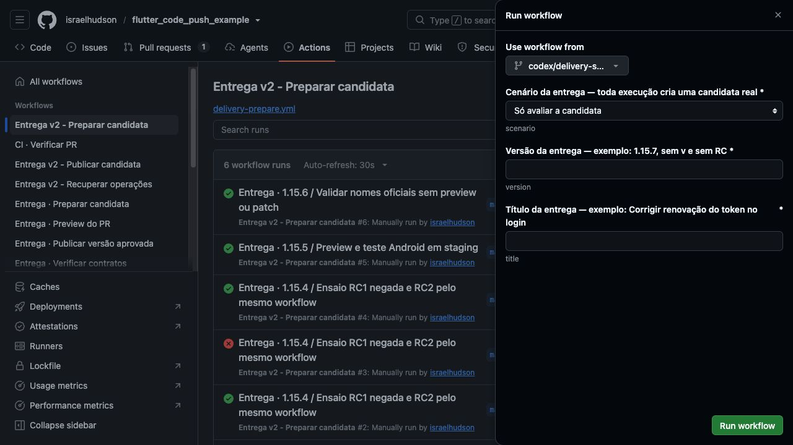
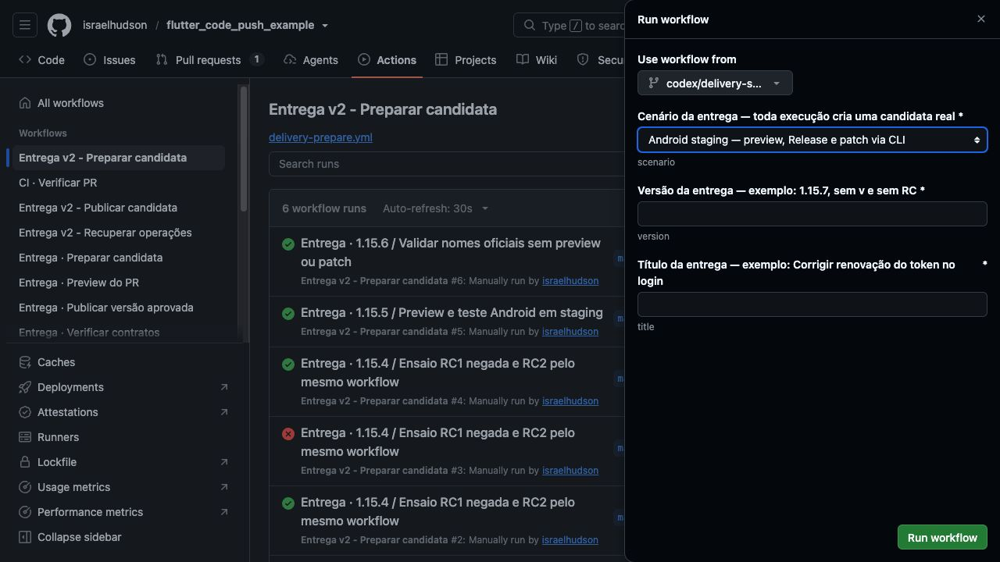

# Validação do formulário por cenário e CLI

Implementação no [PR #66](https://github.com/israelhudson/flutter_code_push_example/pull/66),
em `codex/delivery-scenario-form`, para a `main`.
A [base validada](../../BASE-VALIDADA-FORMULARIO.md) foi registrada no commit
`07aa7c9` e no PR **antes** da alteração dos inputs.

## Conferência do formulário real

Os prints abaixo foram capturados no próprio GitHub Actions, selecionando a
branch do PR em **Use workflow from**. O GitHub carregou os campos dessa branch.
Não foi preenchida versão nem título e **Run workflow não foi submetido**.
As cinco opções foram conferidas na árvore de acessibilidade.

O nome ao fundo ainda vem da `main` anterior. O formulário padrão e o novo
nome do workflow estarão na `main` após o merge; a branch do PR foi usada aqui
somente para a inspeção visual. A automação continua exigindo a integração `main`.





## Verificações concluídas

- Dez testes novos: combinações, equivalência formulário/CLI, inputs inválidos,
  saída do resolver, simulação sem processos e execução contra uma CLI falsa.
- Títulos com aspas, barras e comandos aparentes foram transmitidos como texto
  por JSON; não foram executados. Erros e timeout não causaram retentativa.
- Cinco simulações locais, uma por cenário, sem chamadas remotas.
- Contratos Deno: 94 passaram, zero falhas, com PGlite/mocks locais.
- Suíte Python completa: **631 passaram**, zero falhas. Inclui rejeição, RC2,
  aceites, repetição, recuperação, retenção e autorização Android.
- Actionlint 1.7.12: os dois workflows alterados passaram na validação de sintaxe
  e expressões. ShellCheck/Pyflakes não foram usados nessa verificação.
- Nenhuma alteração nos scripts existentes de preparo, publicação, worker,
  retenção, ponte Android, funções ou migrações Supabase.
- Checks do código `c49759f`: [Flutter e regressões](https://github.com/israelhudson/flutter_code_push_example/actions/runs/38793357309),
  [Entrega](https://github.com/israelhudson/flutter_code_push_example/actions/runs/38793357424)
  e [Issue](https://github.com/israelhudson/flutter_code_push_example/actions/runs/38793357837)
  concluíram com sucesso. Jobs de preview pulados.
- O workflow de preparo continua com seis execuções; a última é
  `38788973624`, da 1.15.6. Os quatro controles GitHub de execução/publicação
  e legado foram reconferidos como `false`.

Essas verificações não são uma nova rodada de publicação. A execução real que
preserva os nomes oficiais continua sendo a 1.15.6; a prova de preview/Android
continua sendo a 1.15.5, com os limites registrados na base.

## Logs e reprodução

Os logs completos ficam em `Documents/Codex/2026-10-15/formulario-cenarios/`
no armazenamento local do operador. Incluem `scenario-tests.log`,
`python-regression.log`, `deno-regression.log`, `actionlint.log`, cinco JSONs de
dry-run e prints originais. `preservation-code.json` confere os caminhos que
permaneceram iguais à base. Não copiar credenciais ou snapshots privados.

```bash
python3 -m unittest discover -s tests/delivery -v
deno task check:poc
python3 tools/delivery/run_delivery.py prepare \
  --scenario release_only --version 1.15.7 --title 'Corrigir o login' --dry-run
```

Ver o [resultado estruturado](verification.json) e o
[manual do formulário/CLI](../../FORMULARIO-E-CLI.md).
